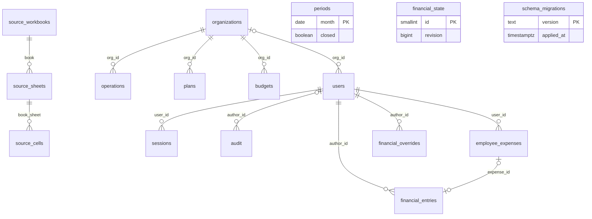

# Qarzhy — PostgreSQL дерекқор архитектурасы

2026-10-20

> **Обновление 2026-10-20:** согласовывается новая предметная реляционная модель
> с ID и FK: [новый проект архитектуры](../superpowers/specs/2026-10-20-relational-finance-design.md).
> Ниже описана прежняя схема экспорта ячеек. Её SQL и 39 INSERT-частей
> не следует продолжать загружать для новой модели. PostgreSQL пока не меняли.


## Толық SQL файлдары және қолдану

Бұл — PostgreSQL-ге көшуге арналған ұсынылған архитектура. Қосымша қазір әлі SQLite қолданады; осы құжат SQL драйверін немесе жұмыс базасын ауыстырмайды.

- [Барлық кестелер, индекстер, шектеулер және триггерлер](../sql/postgres-schema.sql) — бос базаға арналған толық DDL.
- [Негізгі SQL сұраулар](../sql/postgres-queries.sql) — 16 блок (соның ішінде бастапқы кітаптарды оқу және импортты тексеру): аккаунттар, сессиялар, операциялар, кезеңдер, жоспарлар, бюджет, шығындар, мақұлдау, қаржылық жазбалар, Excel түзетулері, P&L, ДДС, аудит және миграциялар.

```sh
psql "$DATABASE_URL" -v ON_ERROR_STOP=1 -f docs/sql/postgres-schema.sql
```

Бұл команданы жеке бос PostgreSQL базасында миграция рөлімен орындаңыз. `postgres-queries.sql` — параметрленген сұраулар анықтамалығы, түгел іске қосылатын скрипт емес. `$1` параметрлері `pg` арқылы беріледі; көп сұраулы транзакциядағы әр SQL жеке шақырылады, барлығы бір client-та орындалады. Қате немесе нұсқа сәйкессіздігі болса `ROLLBACK` міндетті.

Сомалар — KZT `numeric(20,2)`. PostgreSQL `numeric` және `bigint` мәндерін `pg` әдетте жол ретінде қайтарады: дәл decimal арифметикасы немесе API-да decimal string қажет; `Number`-ға соқыр түрлендіруге болмайды. Қазіргі integer-only валидация мен есептеу қабаты көшу кезінде бейімделеді. `financial_overrides.value` және бастапқы Excel ұяшықтары — қосымша дөңгелектеусіз `numeric`.

Логин ASCII және төменгі регистрде болғандықтан `citext` кеңейтімі қажет емес. DDL-дегі `CHECK`, `NOT NULL`, `UNIQUE`, сыртқы кілттер PostgreSQL ресми [constraints құжаттамасына](https://www.postgresql.org/docs/17/ddl-constraints.html), кезең қорғау триггерлері [CREATE TRIGGER](https://www.postgresql.org/docs/17/sql-createtrigger.html) синтаксисіне сүйенеді.

Құқықтарды DBA бөлек береді: `qarzhy_app` DDL, TRUNCATE және схема иесі құқықтарын алмайды; `audit` UPDATE/DELETE және `schema_migrations` жазуы берілмейді. `financial_state` DELETE/INSERT берілмейді. Жаңа аккаунттардың парольдерін seed скрипті scrypt-пен хэштейді; SQL ішінде демо пароль жоқ. Пайдаланушылардың ұйымы NULL болуы мүмкін, сондықтан қызметкер шығыны әзірше жалпы workbook-қа қатысты; ұйым бойынша шығын есебі керек болса org_id-ды шығын мен қаржылық жазбаға бөлек қосу қажет.

P&L/ДДС сұраулары `operations` журналын есептейді. Excel бастапқы файлдары, overrides және financial_entries — бөлек есеп моделі: оларды қосып, бір операцияны екі рет есептеуге болмайды. Қарыз/баланс есебінің ережелері `server/finance/accounting.mjs`-те, Excel есептері `server/finance/workspace.mjs`-те қалады. Толық double-entry бухгалтерия (шоттар жоспары, debit/credit postings) бұл схемаға кірмейді.

Тексеру: схема және толық INSERT файлы PostgreSQL 18.6 WASM (PGlite 0.5.10) ішінде орындалды; жол сандары, ақша қорытындылары, revision, identity тізбектері және қорғау триггерлері тексерілді. Өндірістік PostgreSQL 17 серверіндегі импорт пен көп клиентті жұмыс бөлек тексеріледі.

## Мақсат және қазіргі жағдай

Qarzhy деректерін қосымшаның ішіндегі SQLite файлынан бөлек PostgreSQL серверіне көшіреміз: 16 кесте (қазіргі 12 + жаңа organizations + JSON деректері үшін 3 кесте) бір `qarzhy` схемасына, қатаң типтермен, сыртқы кілттермен және нұсқаланған миграциялармен.

Қазір не бар (кодтан тексерілді):

- Қозғалтқыш — `node:sqlite` (`DatabaseSync`), файл `data/portal.sqlite`, WAL режимі (server/db/open.mjs).
- Схема қосымша іске қосылғанда `CREATE TABLE IF NOT EXISTS` арқылы жасалады; `users` кестесіне бағандар `ALTER TABLE` арқылы қосылады, миграция тек біреу — `accounts-v2` (server/auth/accounts.mjs).
- Барлық сұраулар синхронды (`db.prepare(...).get()`), транзакциялар қолмен `BEGIN/COMMIT`.
- Күндер `TEXT`, логикалық мәндер `INTEGER 0/1`, сыртқы кілттер жоқ, ұйымдар тізімі кодта қатаң жазылған (Qalam Books, Kitap Retail, Dara Distribution).

Неге көшеміз: бірнеше сервер/процесс бір базаға қатар жаза алады, бэкап пен репликация стандартты, деректер тұтастығын база өзі тексереді.

## Жалпы архитектура

Next.js сервері PostgreSQL-ге `pg` пулы арқылы тек `DATABASE_URL` бойынша қосылады; барлық SQL бір қабатқа — `server/db/` репозиторийлеріне жиналады.

| Құрамдас | Шешім |
| --- | --- |
| Сервер | PostgreSQL 17, бөлек хост немесе басқарылатын сервис |
| Дерекқор / схема | `qarzhy` дерекқоры, `qarzhy` схемасы (`public` бос қалады) |
| Драйвер | `pg` (node-postgres), `Pool`, `max` = 10 бір инстансқа |
| Қосылу | `DATABASE_URL`, өндірісте `sslmode=require` |
| Уақыт белдеуі | Серверде `timezone = 'UTC'`, күндер `date`, уақыт белгілері `timestamptz` |
| Миграциялар | `db/migrations/NNNN_name.sql` файлдары + `schema_migrations` кестесі; қосымша схеманы өзгертпейді |
| Орталар | `qarzhy_dev` (жергілікті Docker), `qarzhy_test` (тесттер, әр жүгіруде тазаланады), `qarzhy` (өндіріс) |

Кодқа әсері: `DatabaseSync` синхронды, ал `pg` асинхронды. Сондықтан portal.mjs, accounts.mjs, workspace.mjs ішіндегі барлық `db.prepare(...)` шақырулары `await` болып, транзакциялар `withTransaction(client => ...)` көмекшісіне ауысады (бір транзакция = бір `client`).

## Кестелер

Барлық 12 SQLite кестесі сақталады, төрт жаңа кесте қосылады (`organizations`, `source_workbooks`, `source_sheets`, `source_cells`), `app_migrations` миграция құралының `schema_migrations` кестесімен ауысады. Сомалар теңгемен, тиынды сақтайтын `numeric(20,2)` ретінде, жағдайлар `CHECK` арқылы шектеледі.

### Анықтамалықтар және қолданушылар

| Кесте | Бағандар (PostgreSQL типі) | Кілттер және шектеулер |
| --- | --- | --- |
| `organizations` (жаңа) | `id smallint identity`, `name text`, `active boolean` | PK `id`; `name` UNIQUE. Қазір кодтағы 3 ұйыммен толтырылады |
| `users` | `id bigint identity`, `username text`, `name text`, `role text`, `org_id smallint NULL`, `point text`, `language text DEFAULT 'kk'`, `active boolean`, `must_change_password boolean`, `password_salt text`, `password_hash text`, `created_at timestamptz` | PK `id`; `lower(username)` UNIQUE; логин төменгі регистрде сақталады; `role IN ('admin','finance','employee')`; `language IN ('kk','ru')` |
| `sessions` | `token_hash bytea`, `user_id bigint`, `expires_at timestamptz`, `created_at timestamptz` | PK `token_hash`; FK `user_id → users ON DELETE CASCADE` |

### Бухгалтерлік операциялар

| Кесте | Бағандар (PostgreSQL типі) | Кілттер және шектеулер |
| --- | --- | --- |
| `operations` | `id bigint identity`, `source text`, `external_id text`, `date date`, `org_id smallint`, `point text`, `counterparty text`, `document text`, `kind text`, `amount numeric(20,2)`, `cost numeric(20,2) DEFAULT 0`, `due date NULL`, `article text`, `created_at timestamptz` | PK `id`; UNIQUE `(source, external_id)`; FK `org_id`; `kind` — accounting.mjs ішіндегі `kinds` тізімі (sale, receipt, purchase, …); `amount > 0` |
| `periods` | `month date` (айдың 1-күні), `closed boolean`, `updated_at timestamptz`, `updated_by bigint` | PK `month`; `extract(day from month) = 1` |
| `plans` | `id bigint identity`, `date date`, `org_id smallint`, `article text`, `amount numeric(20,2)`, `direction text` | PK `id`; FK `org_id`; `direction IN ('in','out')` |
| `budgets` | `month date`, `org_id smallint`, `metric text`, `amount numeric(20,2)` | PK `(month, org_id, metric)`; FK `org_id` |

### Қаржылық жұмыс кеңістігі

| Кесте | Бағандар (PostgreSQL типі) | Кілттер және шектеулер |
| --- | --- | --- |
| `employee_expenses` | `id bigint identity`, `user_id bigint`, `date date`, `amount numeric(20,2)`, `category text`, `description text`, `vendor text`, `status text DEFAULT 'submitted'`, `review_note text`, `version integer DEFAULT 1`, `deleted_at timestamptz NULL`, `created_at`, `updated_at timestamptz` | PK `id`; FK `user_id → users`; `status IN ('submitted','approved','rejected')`; `amount > 0` |
| `financial_entries` | `id bigint identity`, `date date`, `kind text`, `amount numeric(20,2)`, `label text`, `note text`, `cash_effect boolean`, `expense_id bigint NULL`, `active boolean`, `author_id bigint`, `created_at`, `updated_at timestamptz` | PK `id`; FK `expense_id → employee_expenses` (UNIQUE); FK `author_id → users`; `kind IN ('revenue','cost','opex','otherExpense','taxes','bonuses','otherIncome','cash_in','cash_out')` |
| `financial_overrides` | `book text`, `sheet text`, `cell text`, `value numeric`, `reason text`, `base_hash text`, `author_id bigint`, `updated_at timestamptz` | PK `(book, sheet, cell)`; FK `author_id → users` |
| `financial_state` | `id smallint`, `revision bigint` | PK `id`; `CHECK (id = 1)` — бір жолдық есептегіш |

### Жүйелік

| Кесте | Бағандар (PostgreSQL типі) | Кілттер және шектеулер |
| --- | --- | --- |
| `audit` | `id bigint identity`, `at timestamptz DEFAULT now()`, `author_id bigint NULL`, `author_name text`, `action text`, `detail text`, `detail_json jsonb NULL` | PK `id`; FK `author_id → users ON DELETE SET NULL`; тек INSERT (өзгертуге болмайды) |
| `schema_migrations` | `version text`, `applied_at timestamptz` | PK `version`; `app_migrations` орнына |

Тип ауыстыру ережелері: `INTEGER 0/1 → boolean`, `TEXT` күн → `date`, ISO уақыт → `timestamptz` (ескі сессиялар көшірілмейді), `deleted 0/1 → deleted_at`, бос `due = ''` → `NULL`, `amount_cents` (тиын) → `amount` (теңге, дәл numeric арифметикасымен ÷ 100). Тиын қалдығы сақталады; база жолдарының саны көшу кезінде қайта өлшенеді.


## JSON деректерінің кестелері

| Кесте | Негізгі бағандар | Байланыс |
| --- | --- | --- |
| `source_workbooks` | `book` (pnl/balance/cashflow), `file_name`, `sha256`, `imported_at` | PK `book` |
| `source_sheets` | `book`, `name`, `position`, `dimension`, `hidden` | PK `(book,name)`, FK → кітап, UNIQUE `(book,position)` |
| `source_cells` | `book`, `sheet`, `address`, `value_type`, `value_number`, `value_text`, `value_boolean`, `formula`, `has_formula`, `metadata` | PK `(book,sheet,address)`, FK → парақ |

Әр ұяшық — жеке жол. Сан `numeric` түрінде масштаб шектеуінсіз, мәтін
`text`, логикалық мән `boolean` түрінде сақталады. `metadata jsonb` тек
ұяшықтың қосымша қасиеттері үшін: formulaAttributes, sharedFormulaOrigin,
error. Бүтін кітапты JSONB ретінде сақтамаймыз. Бос жол мен NULL, формула
өрісінің болмауы мен NULL формуласы ажыратылады. Парақтардың реті мен
атауларындағы соңғы бос орындар сақталады.

Интерфейстің есептері осы бастапқы ұяшықтар + `financial_overrides` +
`financial_entries` негізінде құрылады. Олар `operations` журналынан
есептелетін P&L/ДДС-ке автоматты түрде қосылмайды. Кітаптарды SQL жолдарынан
қазіргі сервер моделіне жинайтын адаптер — қосымшаны PostgreSQL-ге қосу
кезеңінің жұмысы.

## ER диаграммасы және байланыстар



`organizations` бухгалтерлік кестелерін, `users` сессияларды, аудитті және қаржылық жазбаларды байлайды. `periods` сыртқы кілтсіз, бірақ триггер арқылы `operations` пен `financial_entries` жазбаларын жабық айға жібермейді.

## Индекстер, шектеулер, тұтастық

Индекстер кодтағы нақты `WHERE` / `ORDER BY` сұрауларына қарай таңдалды; PK мен UNIQUE индекстері бөлек жазылмайды.

| Индекс | Қай сұрауға |
| --- | --- |
| `operations (date, id)` | Барлық операциялар күн бойынша (`ORDER BY date,id`) |
| `operations (org_id, date)` | Ұйым бойынша есептер |
| `sessions (user_id)`, `sessions (expires_at)` | Қолданушының сессияларын өшіру, ескіргендерді тазалау |
| `employee_expenses (user_id, date) WHERE deleted_at IS NULL` | Қызметкердің өз шығындары |
| `employee_expenses (status) WHERE deleted_at IS NULL` | Қараудағы өтінімдер тізімі |
| `financial_entries (date, id) WHERE active` | `WHERE e.active=1 ORDER BY e.date,e.id` |
| `audit (id DESC)` — PK жеткілікті | Соңғы 100/300 жазба |
| `plans (date)` | Жоспарлар күн бойынша |

Тұтастық ережелері:

- Жабық кезеңге жазуды қазір код тексереді. Ұсынылған SQL-де `operations`, `financial_entries`, `budgets` үшін `BEFORE INSERT OR UPDATE OR DELETE` триггерлері бар: ескі және жаңа ай тексеріледі. `periods` кестесінің SHARE құлпы кезеңді қатар жабумен жарысуды болдырмайды (READ COMMITTED, қысқа транзакциялар).
- Тұрақты жаңарту: `employee_expenses.version` — `UPDATE … WHERE id=$1 AND version=$2`; 0 жол жаңарса → 409.
- `financial_state.revision` өсуін `financial_entries` және `financial_overrides` триггерлері бір транзакцияда жасайды. Қосымша оны екінші рет өсірмейді.
- Импортта қайталануды алдын ала `SELECT` емес, `INSERT … ON CONFLICT (source, external_id) DO NOTHING RETURNING id` тексереді.
- Қате хабарлары: қазір код `"UNIQUE"` және `"users.username"` мәтінін іздейді; PostgreSQL-де `err.code === '23505'` және `err.constraint` атын тексеру керек.

## Қауіпсіздік, рөлдер, бэкап

Қосымша базаға иесі емес, шектеулі рөлмен қосылады; схеманы тек миграция рөлі өзгертеді.

| Рөл | Құқықтары | Кім қолданады |
| --- | --- | --- |
| `qarzhy_owner` | Схема иесі, DDL | Миграциялар (CI/деплой) |
| `qarzhy_app` | `SELECT, INSERT, UPDATE, DELETE` барлық кестелерге; `audit`-қа тек `SELECT, INSERT`; `schema_migrations` тек SELECT; `financial_state` SELECT/UPDATE (триггерге қажет) | Next.js сервері |
| `qarzhy_readonly` | Тек `SELECT` | Аналитика, қолмен тексеру |

- Парольдер бұрынғыдай scrypt арқылы қосымшада хэштеледі; база тек тұз бен хэшті сақтайды.
- Сессия токені базада ашық сақталмайды: `token_hash = sha256(token)`. Базадағы хэштің өзі cookie ретінде қолданылмайды; кездейсоқ токен криптографиялық генератормен жасалады.
- `.initial-access.txt` файлы қазір `DB_PATH` жанына жазылады; PostgreSQL-де бұл жол жоқ, сондықтан бастапқы аккаунттар бөлек `seed` скриптімен жасалады.
- Бэкап: тәулігіне `pg_dump -Fc`, 30 күн сақтау; WAL архиві арқылы уақыт нүктесіне қалпына келтіру (PITR). Айына бір рет `qarzhy_restore_check` базасына қалпына келтіріп тексеру.
- Ескірген сессияларды тазалау: `DELETE FROM sessions WHERE expires_at < now()` — кіру кезінде немесе cron арқылы.

## SQLite-тан көшу жоспары

Көшу бір жолғы кесумен жүреді: жазуды тоқтатып, деректерді скриптпен көшіріп, сандарын салыстырып, қосымшаны `DATABASE_URL`-ға ауыстырамыз.

1. `db/migrations/0001_init.sql` — жоғарыдағы кестелер, индекстер, рөлдер; `0002_closed_period_trigger.sql` — жабық кезең триггері.
2. `server/db/open.mjs` → `server/db/pool.mjs`: `Pool`, `query()`, `withTransaction()`. `CREATE TABLE IF NOT EXISTS` мен `ALTER TABLE` кодтан алынып тасталады.
3. Сұрауларды асинхронды ету: `?` → `$1, $2`, `INSERT OR IGNORE` → `ON CONFLICT DO NOTHING`, `COLLATE NOCASE` → `lower(username)`, `db.isTransaction` → `withTransaction`.
4. Сомаларды теңгеге көшіру: accounts.mjs және workspace.mjs ішіндегі `amount_cents` → `amount`, `amount_cents / 100` бөлуі алынады; API мен фронтендтің қазіргі `amount_cents` форматы сақталады; API шекарасында сервер нақты decimal арифметикасымен тиын мен теңгені түрлендіреді.
5. `python3 scripts/export_postgres.py`: SQLite snapshot және үш JSON файлынан `data/postgres-data.sql` INSERT файлын жасайды. ID, дәл decimal сомалар, формулалар мен метадеректер сақталады. Импорт соңында `setval()` identity тізбектерін жылжытады. Толық нұсқаулық төменде.
6. Сессиялар көшірілмейді — барлық қолданушылар қайта кіреді (токен енді хэшпен сақталады).
7. Тексеру: көшірілетін кестелердің жол саны бірдей (сессиялар алынып тасталады, бастапқы ұйымдар мен миграция жазбалары бөлек ескеріледі); `sum(amount)` PostgreSQL-де = SQLite-тағы `sum(amount)` немесе `sum(amount_cents) / 100`; `financial_state.revision` бірдей.
8. Тесттер: `tests/helpers` ішінде әр тест файлы өз схемасын (`test_<pid>`) жасап, соңында өшіреді; жергілікті PostgreSQL `docker compose` арқылы.
9. Деплой: жазуды тоқтату → SQLite бэкапы → 5–7 қадамдар → жаңа нұсқаны іске қосу. SQLite файлы қайтару үшін 30 күн сақталады.

Ашық сұрақ: PostgreSQL қайда орналасады — өз серверіңіз бе әлде басқарылатын сервис пе? Бэкап пен PITR баптауы соған байланысты.


## Дайын SQL файлдарын қолдану

Екі файлды ретімен **бос PostgreSQL базасына** орындаңыз. Схемада тек бастапқы
3 ұйым, `revision=0` және бастапқы миграция жазбасы болады. Деректер файлы
өзге деректер бар базаға жүктеуді қате арқылы тоқтатады; кестелерді тазаламайды.

```sh
# Экспортты жаңарту: Python 3.9+, қосымша пакеттер қажет емес.
python3 scripts/export_postgres.py

# Нақты базаға қосылуды өз ортаңызда орнатыңыз.
psql "$DATABASE_URL" -X -v ON_ERROR_STOP=1 -f docs/sql/postgres-schema.sql
psql "$DATABASE_URL" -X -v ON_ERROR_STOP=1 -f data/postgres-data.sql
```

`data/postgres-data.sql` — пакеттелген INSERT сұраулары, бір транзакция.
`data/postgres-data.manifest.json` — экспорт уақыты, файл хэштері, жол
сандары және ақша қорытындылары. Екі файл да жергілікті, Git-ке кірмейді:
қаржылық деректер мен пароль хэштері бар. Ашық парольдер экспортталмайды.
`postgres-queries.sql` — анықтамалық; оны түгел орындауға болмайды.

2026-10-20 алынған snapshot: 3 кітап, 38 парақ, 385 661 ұяшық; 954 операция,
12 пайдаланушы, 30 жоспар, 4 шығын, 4 қаржылық жазба, 42 аудит жазбасы.
Нақты жаңа экспорт саны manifest файлынан алынады. 4 ескі сессия
экспортқа кірмейді, қайта кіру қажет. SQLite миграция тарихы
`schema_migrations` ішінде `legacy:sqlite:` префиксімен сақталады.

Импорт жабық кезеңдерді қаржылық жазбалардан кейін жүктейді; revision
триггерлерден кейін бастапқы мәнге қайтарылады. Жойылған шығындарда нақты
жойылу уақыты жоқ: `deleted_at` үшін бастапқы `updated_at` қолданылады.
SQLite-та болмаған жаңа уақыт өрістері snapshot уақытын алады.

Тексеру командалары:

```sh
python3 -m unittest discover -s tests -p 'postgres_export_test.py'
python3 scripts/verify_postgres_export.py
```

Екінші команда INSERT мәндерін кері оқып, барлық кітаптарды бастапқы JSON-мен,
ақша сомаларын SQLite-пен салыстырады. Ол PostgreSQL DDL/триггерлерін орындамайды.
Толық схема және INSERT PostgreSQL 18.6 WASM (PGlite 0.5.10) ішінде
тексерілді: 16 кесте, барлық жолдар, ақша қорытындылары, revision=4,
identity тізбектері, қайталама импортты және жабық кезеңді қорғау. Импортталған
385 661 ұяшықтың мәні, формуласы және метадеректері бастапқы JSON-мен дәл
салыстырылды. Бұл ортада psql/Docker жоқ; өндірістік PostgreSQL 17 және
бірнеше қатар клиентпен тексеру бөлек қажет. SQL дайындау және тексеру жұмыс істеп тұрған қосымшаны
PostgreSQL-ге ауыстырмайды: әзірге сайт SQLite пен JSON-ды қолданады.
