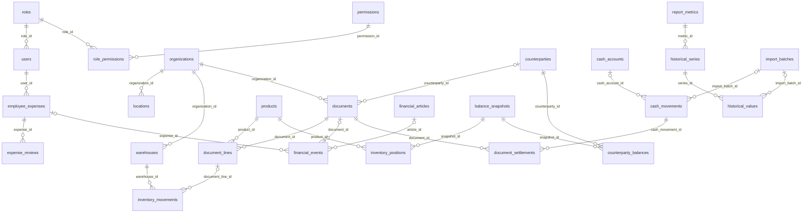

# Qarzhy — реляционная архитектура PostgreSQL

Дата: 2026-10-20. База: **fin**. Схема: **qarzhy**.
Статус: архитектура для согласования перед новой реализацией.

Это целевая модель финансовой программы. Предыдущая схема хранения
Excel-ячеек и её INSERT-файлы не соответствуют этой модели.
Работающая PostgreSQL и исходные данные при подготовке документа не менялись.

## Назначение

После первоначального переноса финансист работает только в программе.
PostgreSQL хранит справочники, документы, расходы, движения денег и остатки;
отчёты рассчитываются сервером по этим сущностям. Excel, JSON и координаты
ячеек не используются как рабочая модель и не нужны для запуска сайта.

Продажи и закупки вводятся двумя способами: общей суммой или товарными
строками с количеством и ценой. Поддерживаются частичная оплата, возвраты,
задолженность, планы, бюджеты и расходы сотрудников с согласованием.

Область этой модели — управленческий учёт. Это не заявленная реализация
регламентированной бухгалтерии, налогового учёта или полноценной двойной записи.

## Ключи и общие типы

- У каждой таблицы есть `id bigint GENERATED BY DEFAULT AS IDENTITY PRIMARY KEY`.
  FK ссылаются на эти ID; названия, артикулы и Excel-адреса не заменяют ссылки.
- `!` ниже означает NOT NULL, `?` — допускает NULL, `→` — FK.
- Рабочие денежные суммы: `numeric(20,2)` KZT. Цена/количество: `numeric(24,6)`.
  Исходные исторические значения: `numeric` без округления при переносе.
- Дни: `date`; события: `timestamptz`, UTC. Периоды — полуоткрытые `[from,to)`.
- Рабочие документы имеют `created_at`, `updated_at`, `created_by → users`,
  `version integer > 0`; справочники — `active boolean`.
- Факты не удаляются каскадом вместе со справочником. Используются RESTRICT,
  деактивация и сторно; пользовательские изменения записываются в аудит.
- UNIQUE применяются отдельно от ID там, где есть подтверждённый бизнес-ключ.
  Две записи не связываются только из-за совпадения имени или суммы.

## 1. Пользователи и права

| Таблица | Поля помимо id | Ограничения |
| --- | --- | --- |
| `roles` | code!, name! | UNIQUE code: admin, finance, employee |
| `permissions` | code!, description! | UNIQUE code |
| `role_permissions` | role_id! → roles, permission_id! → permissions | UNIQUE пары |
| `user_permissions` | user_id! → users, permission_id! → permissions, allowed! | UNIQUE пары; персональное назначение администратора |
| `users` | username!, name!, role_id! → roles, organization_id? → organizations, location_id? → locations, language!, active!, must_change_password!, password_salt!, password_hash! | UNIQUE lower(username); пароль не хранится открыто |
| `sessions` | user_id! → users, token_hash!, created_at!, expires_at! | UNIQUE hash; срок после создания |
| `audit_log` | actor_id? → users, actor_name!, action!, occurred_at!, entity_type?, entity_id?, before_data?, after_data?, reason? | Неизменяемый журнал; historical entity_id — аудиторская метка, не универсальный FK |

Администратор имеет полный функциональный доступ, управляет пользователями,
ролями/правами, именами, логинами и паролями. Финансист ведёт финансы и
проверяет расходы, но не управляет аккаунтами. Сотрудник создаёт и видит
только собственные расходы и решения по ним. Начальный набор — 8 сотрудников
плюс администратор и финансист; количество пользователей не ограничено восемью.

Для employee ограничение собственными расходами действует независимо от
персональных разрешений: расширенный финансовый доступ требует смены роли.
Администратор не может отключить последнего активного администратора.
Сброс пароля требует смены временного пароля и отзывает сессии. Права
проверяются на сервере, а не только скрытием элементов интерфейса.

## 2. Справочники

| Таблица | Поля помимо id | Ограничения |
| --- | --- | --- |
| `organizations` | code!, name!, active! | UNIQUE code |
| `locations` | organization_id! → organizations, code!, name!, active! | UNIQUE organization_id/code |
| `warehouses` | organization_id! → organizations, location_id? → locations, code!, name!, active! | UNIQUE organization_id/code |
| `counterparties` | name!, external_namespace?, external_code?, active! | UNIQUE подтверждённого namespace/code, имя не уникально |
| `counterparty_roles` | counterparty_id! → counterparties, role! | UNIQUE пары; customer/supplier/publisher/other |
| `products` | name!, sku_namespace?, sku?, unit!, active! | UNIQUE подтверждённого namespace/sku |
| `agreement_types` | code!, name! | UNIQUE code; в том числе предоплата/реализация |
| `financial_articles` | code!, name!, parent_id? → financial_articles, sort_order!, active! | UNIQUE code; нет циклов дерева |
| `sales_channels` | code!, name!, location_id? → locations, active! | UNIQUE code; канал не обязательно магазин |
| `cash_accounts` | organization_id? → organizations, code!, name!, account_type!, currency!, active! | UNIQUE code; для новых операций владелец обязателен |
| `persons` | name!, user_id? → users, active! | Исторические авторы/ответственные Excel не сливаются с аккаунтами по имени |
| `asset_groups` | code!, name! | UNIQUE code |

Для ссылки на точку/склад дополнительно контролируется принадлежность
организации документа. Артикулы без доказанного пространства кодов не
используются для автоматического объединения товаров.

## 3. Контекст данных и периоды

| Таблица | Поля помимо id | Ограничения |
| --- | --- | --- |
| `datasets` | code!, name!, kind! | UNIQUE code; live / imported_finance / legacy_ledger |
| `report_scopes` | scope_type!, organization_id? → organizations | consolidated без организации либо organization с FK; UNIQUE NULLS NOT DISTINCT пары |
| `accounting_periods` | organization_id! → organizations, starts_on!, closed!, updated_by? → users, updated_at! | UNIQUE organization_id/starts_on; первый день месяца |
| `coverage_rules` | dataset_id! → datasets, scope_id! → report_scopes, report_family!, metric_id? → report_metrics, starts_on!, ends_on!, source_kind!, opening_snapshot_id? → balance_snapshots | Источник данных для заданного отчёта/периода; пересекающиеся правила одинаковой области запрещены |

`legacy_ledger` из SQLite отделён от реальных workbook-данных: их суммы
нельзя автоматически складывать. Исторические и новые факты переключаются
по правилам coverage, а не просто по дате импорта.

Для баланса переход задаёт проверенный opening snapshot и диапазон новых
движений после него. Для P&L и ДДС переход может иметь другую границу:
исторический баланс, Cash Flow и P&L покрывают разные периоды.
До согласования точных границ приложение не объединяет их в один отчёт.
Пропуски покрытия и расхождения показываются явно.

## 4. Документы продаж, закупок и возвратов

| Таблица | Поля помимо id | Ограничения |
| --- | --- | --- |
| `documents` | dataset_id!, organization_id!, location_id?, counterparty_id?, channel_id?, article_id?, agreement_type_id?, kind!, input_mode!, number!, document_date!, due_date?, status!, total_amount!, cogs_amount?, reverses_document_id? → documents, idempotency_key! | Все *_id — FK на соответствующие справочники; UNIQUE dataset/idempotency_key |
| `document_lines` | document_id! → documents, line_number!, product_id! → products, warehouse_id? → warehouses, quantity!, unit_price!, discount_amount!, line_amount!, cogs_amount?, original_line_id? → document_lines | UNIQUE document/line_number; quantity>0, price≥0, скидка не выше суммы строки |
| `document_settlements` | document_id! → documents, cash_movement_id! → cash_movements, amount! | UNIQUE пары, amount>0; ограничения распределения проверяются под блокировкой |

Типы документов: sale, purchase, sale_return, purchase_return.
Режимы: summary, itemized. Статусы: draft, posted, reversed.

- Summary хранит общую сумму и не изменяет товарные остатки.
- Itemized хранит строки; сумма документа равна сумме строк.
- При проведении itemized обязан иметь строки, summary не имеет строк.
  Достоверный контрагент обязателен, если документ образует задолженность;
  для неизвестного исторического контрагента сохраняется отдельная проблема импорта.
- Нельзя повторно учитывать заголовок, строки и финансовые факты как три продажи.
- Проведение и сторно — транзакционные операции с уникальным ключом события.
  Опубликованные документы исправляются через контролируемую отмену/замену,
  история и исходные связи сохраняются.
- Возвраты не превышают исходную доступную сумму/количество; изменения
  блокируют исходный документ/строку. Возврат денег — отдельная денежная операция.

Точные правила НДС и распределения скидок не заданы пользователем. На первом
этапе сумма является введённой итоговой суммой, налог не вычисляется из неё
догадкой. Налоговые события вводятся отдельно; отдельный налоговый модуль
потребует собственных правил.

## 5. Финансовые факты и деньги

| Таблица | Поля помимо id | Ограничения |
| --- | --- | --- |
| `financial_events` | dataset_id!, scope_id!, organization_id?, occurred_on!, event_kind!, article_id?, channel_id?, counterparty_id?, document_id?, document_line_id?, expense_id?, amount!, cost_amount?, author_id?, reverses_event_id? → financial_events, posting_key! | FK на соответствующие сущности; UNIQUE dataset/posting_key; один исходный расход — одно событие признания |
| `cash_movements` | dataset_id!, scope_id!, organization_id?, cash_account_id?, occurred_on!, direction!, amount!, article_id?, counterparty_id?, responsible_person_id?, author_person_id?, expense_id?, note!, reverses_movement_id? → cash_movements, posting_key! | FK; direction=in/out, amount>0 для новых записей; UNIQUE dataset/posting_key |
| `cash_transfers` | outgoing_id! → cash_movements, incoming_id! → cash_movements | UNIQUE каждой стороны; равные суммы/валюта, разные счета, общая транзакция |

В отличие от прежнего проекта `financial_entries` и `operations` не являются
двумя параллельными источниками одного расхода: текущий журнал преобразуется
в financial_events и/или cash_movements по смыслу исходного kind.
SQLite IDs сохраняются в таблице соответствий, если целевая сущность другая.

P&L считается из financial_events; ДДС — из cash_movements.
Продажа признаёт выручку и долг; её оплата меняет деньги и погашает долг,
не создавая вторую выручку. Поступление товара не объявляется сразу расходом P&L:
расход себестоимости возникает при продаже. Налоги, капитал, займы,
погашения и амортизация имеют отдельные виды событий и правила влияния.

Внутренний перевод имеет две связанные стороны; в сводном ДДС он исключается,
но движение на каждом счёте видно. Импортированное «Пополнение кассы» не
объявляется переводом без подтверждённой второй стороны: сохраняются
исходная классификация и существующее предупреждение.

Одна строка Excel с входящим и исходящим потоком создаёт две денежные записи,
с общим ключом исходной строки в отчёте миграции и разными posting_key. Это не дублирование.
Исторические отрицательные значения сохраняются с точным знаком в архиве
и переводятся в положительную сумму/противоположное направление по явно
зафиксированному правилу, с проверкой исходного signed net.

Распределения document_settlements не превышают сумму платежа и доступный
долг документа; проверка выполняется транзакционно. Переплата остаётся
нераспределённым авансом, а не исчезает из остатка.

## 6. Остатки товаров, денег и долгов

| Таблица | Поля помимо id | Ограничения |
| --- | --- | --- |
| `balance_snapshots` | dataset_id!, scope_id!, as_of_date!, label!, status! | Версия снимка, источник даты и проверка полноты |
| `inventory_positions` | snapshot_id!, product_id!, warehouse_id?, publisher_id?, agreement_type_id?, quantity!, unit_cost?, total_value! | FK на snapshot/products/warehouses/counterparties/agreement_types; отдельные исходные строки не сливаются |
| `inventory_movements` | organization_id!, product_id!, warehouse_id!, document_line_id?, occurred_on!, quantity_delta!, value_delta?, source_position_id?, reverses_movement_id? → inventory_movements, posting_key! | FK; ненулевое количество, UNIQUE posting_key; проводятся только подтверждённые товарные документы |
| `cash_balances` | snapshot_id!, cash_account_id!, amount! | FK; исходные остатки, не фиктивные платежи |
| `counterparty_balances` | snapshot_id!, counterparty_id!, balance_kind!, amount!, due_date? | FK; receivable/payable, сумма может отражать авансы по явному правилу |
| `asset_group_balances` | snapshot_id!, asset_group_id!, amount! | FK; группы активов и их оценка |

Рабочий остаток = проверенный начальный остаток + последующие движения.
Периодический контрольный snapshot сам по себе не добавляется как движение.
Детализация и опубликованный итог могут расходиться; расхождение переносится,
а не исправляется выдуманной проводкой.

Себестоимость: структура хранит точную стоимость начальных остатков,
поступлений и списаний. До утверждения метода оценки нельзя автоматически
объявить FIFO или среднюю стоимость действующим правилом. Для первого
проведения допускается явно заданная финансистом себестоимость с основанием;
неизвестная стоимость — NULL и предупреждение о неполной прибыли, не ноль.
Автоматическая оценка, задние даты и отрицательные остатки — отдельные
обязательные правила до включения автоматического складского расчёта.

## 7. Расходы сотрудников

| Таблица | Поля помимо id | Ограничения |
| --- | --- | --- |
| `employee_expenses` | user_id!, organization_id?, article_id!, occurred_on!, amount!, description!, vendor_id?, vendor_label!, status!, version!, deleted_at?, reviewed_by?, reviewed_at? | FK на users/organizations/articles/counterparties; amount>0; статус submitted/approved/rejected |
| `expense_reviews` | expense_id!, reviewer_id!, decision!, note!, reviewed_at!, expense_version! | FK; история всех решений сохраняется |

Сотрудник отправляет только свой расход; user_id берётся из сессии.
Submitted/rejected не входят в фактические расходы. Одобрение финансистом
или администратором одной транзакцией создаёт одно financial_event,
сохраняет решение и аудит. UNIQUE posting_key/expense_id для события
признания и проверка версии предотвращают двойное включение.

После одобрения сотрудник запись не меняет. Повторная отправка отклонённой
заявки увеличивает version. Отмена одобрения сторнирует финансовый факт,
сохраняя исходные записи. Фактическая оплата/возмещение — отдельный
cash_movement; approval не означает автоматического списания денег.

## 8. Планирование и исторические отчёты

| Таблица | Поля помимо id | Ограничения |
| --- | --- | --- |
| `payment_plans` | organization_id!, article_id!, counterparty_id?, document_id?, planned_on!, direction!, amount!, status! | FK; план отделён от факта |
| `budget_versions` | scope_id!, year!, name!, status!, approved_by?, approved_at? | FK; draft/approved/archived |
| `budget_items` | budget_version_id!, month!, metric_id!, article_id?, channel_id?, amount! | FK; UNIQUE NULLS NOT DISTINCT набора измерений |
| `report_metrics` | code!, name!, unit!, calculation_kind! | UNIQUE code; amount/ratio/quantity |
| `historical_series` | dataset_id!, scope_id!, report_family!, metric_id!, article_id?, channel_id? | FK; UNIQUE NULLS NOT DISTINCT измерений |
| `historical_values` | series_id!, period_start!, period_end!, period_kind!, value?, availability! | FK; UNIQUE series/границы/period_kind; reported/missing/not_available |
| `financial_adjustments` | historical_value_id?, financial_event_id?, inventory_position_id?, cash_balance_id?, counterparty_balance_id?, asset_group_balance_id?, reason!, author_id!, previous_value?, new_value!, created_at! | FK; CHECK ровно одна целевая ссылка; история неизменяема |
| `financial_state` | revision! | Единственный глобальный счётчик; UNIQUE singleton marker |

Исторические месячные и исходные годовые показатели хранятся отдельно:
годовой итог Excel может отличаться от суммы месяцев. Он не складывается
с ними. Исходные бюджетные итоги без детализации также сохраняются в
historical_values; новые бюджеты вводятся через budget_versions/items.

Отчёт выбирает исторический показатель или рассчитанный набор событий
согласно coverage_rules. Рабочие исправления адресуются ID предметной записи,
а не Excel-ячейке; проведённые события исправляются сторно/заменой, не
скрытой перезаписью. Исправления snapshot не подменяют историю движений.

## 9. Однократный перенос в предметные таблицы

| Таблица | Поля помимо id | Ограничения |
| --- | --- | --- |
| `import_batches` | fingerprint!, started_at!, finished_at?, status!, summary? | UNIQUE fingerprint |
| `import_entity_mappings` | import_batch_id! → import_batches, namespace!, source_key!, organization_id?, location_id?, product_id?, counterparty_id?, person_id?, article_id?, channel_id?, cash_account_id?, document_id?, financial_event_id?, cash_movement_id? | Все *_id — FK; CHECK одна цель; UNIQUE import_batch/namespace/key |
| `import_issues` | import_batch_id!, source_ref?, code!, detail!, status! | FK; неоднозначные данные не пропускаются молча |
| `schema_migrations` | version!, applied_at! | UNIQUE version |

Данные читаются из Excel/JSON и SQLite непосредственно мигратором и
записываются в предметные таблицы. Таблиц `source_files`, `source_sheets`,
`source_rows`, `source_cells` в целевой схеме нет. Временное представление
ячеек допускается только внутри мигратора, вне рабочей схемы.

| Исходные данные | Куда переносятся |
| --- | --- |
| Организации, точки, статьи, ответственные, контрагенты | Соответствующие справочники с ID |
| Товарный список с артикулами и издательствами | products, counterparties и counterparty_roles |
| Количество, цена и стоимость товарных остатков | balance_snapshots и inventory_positions |
| Строки фактического прихода и расхода денег | cash_movements, financial_articles, persons; связь с документом только при подтверждении |
| Остатки касс/счетов, задолженностей и активов | cash_balances, counterparty_balances, asset_group_balances |
| Детальные продажи/закупки при достаточной первичке | documents и document_lines; проведение создаёт связанные факты один раз |
| P&L по месяцам, каналам и исходные годовые итоги без первички | historical_series и historical_values со ссылками на метрики, статьи, каналы, периоды |
| Бюджетные строки с подтверждёнными измерениями | budget_versions и budget_items; недетализированные итоги — historical_values |
| Пользователи, расходы, решения и аудит SQLite | users, employee_expenses, expense_reviews, financial_events, audit_log |
| Старые исправления Excel-ячеек | Применяются при миграции к целевым предметным значениям; сохраняются автор, причина, исходное и исправленное значения |

У импортируемых предметных записей есть nullable `import_batch_id →
import_batches` и стабильный `external_key`; UNIQUE пары обеспечивает
повторяемость переноса. Разрешённая кратность задаётся отдельно для каждой
сущности: одна исходная строка может дать и справочник, и денежный факт,
либо две денежные записи с разным направлением. Мигратор не создаёт
финансовое признание повторно из исходного итога.

Адреса наподобие C8319 и имена исходных листов могут быть записаны в
локальный отчёт миграции и `import_issues.source_ref` для диагностики,
но не выступают рабочими ключами или внешними связями.

Сохраняются все бизнес-данные. Из 385 661 ячейки не создаётся столько же
рабочих записей: заголовки, пустые разделители, технические копии, формулы
и повторяющиеся суммы не являются самостоятельными финансовыми фактами.
Весь исходный набор файлов остаётся отдельным неизменяемым архивом.
Отчёт миграции классифицирует каждую исходную область: предметные факты,
исторические показатели, контрольные итоги либо технические данные архива.
Неопознанные значимые области блокируют завершение переноса.

Формулы заменяются расчётами программы. Отсутствующая первичка не
восстанавливается догадкой: исторические агрегаты сохраняются именно
как исторические показатели. Старые overrides применяются с проверкой
base_hash; неактуальные исправления отражаются в отчёте миграции.

## ER-диаграмма основных связей

Диаграмма отражает основные маршруты данных; каталог выше задаёт также
прочие FK. Межтабличные суммы, принадлежность организаций и статусы
проверяются процедурой проведения и отложенными ограничениями БД.

## Проведение и целостность

1. Начать транзакцию, проверить права и idempotency_key, заблокировать документ
   и затрагиваемые остатки/период в установленном порядке.
2. Проверить открытый период, организацию всех ссылок, тип документа, строки,
   суммы, доступность товара и стоимость. Не создавать неизвестные значения.
3. Создать financial_events, inventory_movements и необходимые связи по типу
   события; для оплаты — cash_movements и document_settlements.
4. Обновить статус/version, сохранить аудит и увеличить глобальный revision
   один раз за логическую операцию. COMMIT, либо полный ROLLBACK при ошибке.

Черновики на отчёты не влияют. Конкурентное закрытие периода синхронизируется
с проведением; два клиента не могут одновременно потратить один доступный
остаток или распределить один платёж сверх его суммы.

Индексы: все внешние ключи; фильтры организации/даты; dataset/scope/даты;
статус и владелец расходов; период бюджетов и исторических серий; уникальные
ключи проведения и импорта. Параметризованные запросы, шифрованное подключение,
ограниченная роль приложения, отдельная роль миграций и проверяемый backup.

## План переноса в fin.qarzhy

1. Утвердить каталог сущностей и правила отчётов; зафиксировать границы
   исторического покрытия и автоматическую оценку себестоимости.
2. Подготовить новую DDL и мигратор на временной тестовой PostgreSQL.
3. SQLite и JSON читать как один зафиксированный набор источников. Маппировать
   названия на ID без слияния неоднозначных контрагентов/товаров.
4. Детальные строки Cash Flow перенести в cash_movements; остатки товаров,
   денег и долгов — в snapshot-таблицы; P&L и иные недетализированные итоги —
   в historical_values. Не придумывать документы из агрегатов.
5. Проверить каждый FK, число исходных записей, суммы, знаки, исходные ID,
   все периоды отчётов и существующие предупреждения. Старые сессии не переносить.
6. Снять и проверить резервную копию текущей qarzhy. Только после этого
   отдельно подтверждённым скриптом заменить её новой схемой и данными.
7. Переключить сервер на PostgreSQL, проверить роли, расходы, продажи,
   закупки, оплаты, возвраты, остатки, P&L/ДДС/баланс и экспорт.
8. Убрать чтение Excel/JSON из рабочего пути. Исходные файлы, отчёт миграции и backup сохранить вне рабочей модели.

Старые `postgres-schema.sql`, `postgres-data.sql` и 39 частей — артефакты
предыдущей модели, не скрипты для этой архитектуры. Они не запускаются повторно.
Этот документ не является подтверждением выполненной миграции.
