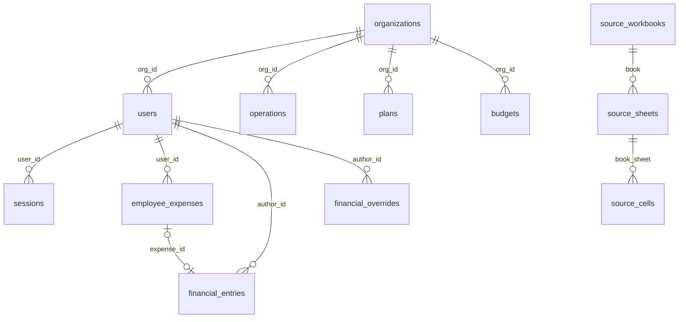

# PostgreSQL: архитектура и перенос текущих данных Qarzhy

Дата: 2026-10-20. Ветка: `feat/postgres-migration`.
Статус: структура принята; SQL-артефакты подготовлены. Решения уточнены ниже и в основном документе.

## Результат

Создать схему PostgreSQL и отдельный файл с текущими данными SQLite и трёх
JSON-книг. Сохранить данные, из которых строится существующий интерфейс:
операции, пользователей, расходы, ручные записи, исправления, бюджет,
P&L, баланс и движение денежных средств. Интерфейс и формат API не меняются.

На этом этапе готовятся переносимые SQL-артефакты. Переключение приложения
с синхронного SQLite на асинхронный `pg` — отдельный этап; импорт SQL сам
по себе не переключает работающий сайт на PostgreSQL.

## Проверенные источники

SQLite: `data/portal.sqlite`, с учётом WAL через штатный SQLite API.
Снимок следует читать в одной транзакции, не копированием одного `.sqlite`.

| Источник | Содержимое | Проверенный объём |
| --- | --- | --- |
| SQLite | 12 таблиц приложения | 954 операции, 30 планов, 12 пользователей, 42 записи аудита, 4 расхода, 4 финансовые записи, 4 сессии; объём может меняться |
| `data/workbook-source.json` | P&L, продажи, бюджет | 23 листа, 12 177 ячеек |
| `data/balance-source.json` | Баланс и его детализация | 7 листов, 58 750 ячеек |
| `data/cashflow-source.json` | История движения денег, справочники, своды | 8 листов, 314 734 ячейки |

Всего в книгах: 38 листов, 385 661 ячейка, 26 146 ячеек с непустой формулой.
Это контрольные показатели обследования, а не зафиксированные навсегда
значения: при экспорте они вычисляются заново.

## Выбранный подход

Реляционные таблицы для сущностей приложения и отдельные строки для
книг, листов и ячеек. Полные JSON-файлы не сохраняются одним документом.
Текущие функции расчёта можно будет использовать, собирая прежнюю структуру
книг из строк PostgreSQL в серверном адаптере.

Альтернатива «один JSONB на книгу» проще для загрузки, но не выполняет
требование хранить содержимое в виде таблиц. Немедленное преобразование
всех Excel-ячеек исключительно в бухгалтерские операции требует новых
правил интерпретации и может изменить отчёты. Поэтому оно не входит в перенос.

## Таблицы приложения

Схема `qarzhy`, PostgreSQL 17+. Основа — существующий
`docs/sql/postgres-schema.sql`, дополненный таблицами источников ниже.

| Таблица | Назначение и связь с текущими данными |
| --- | --- |
| `organizations` | Уникальные организации из текущих данных; текстовый `org` заменяется ссылкой `org_id` |
| `users` | ID, логин, имя, роль, организация, точка, язык, активность, необходимость смены пароля, соль и хэш |
| `sessions` | Новые сессии PostgreSQL: хэш токена, пользователь, срок действия; старые сессии не импортируются |
| `operations` | ID и все поля текущего журнала, организация через FK; уникальность `(source, external_id)` |
| `periods` | Месяц, признак закрытия, метаданные изменения |
| `plans` | ID, дата, организация, статья, сумма, направление |
| `budgets` | Месяц, организация, показатель и сумма |
| `employee_expenses` | Расходы, автор, дата, категория, описание, поставщик, статус, комментарий, версия, удаление и временные метки |
| `financial_entries` | Ручные и созданные из расходов финансовые записи, активность, влияние на деньги, автор |
| `financial_overrides` | Книга, лист, ячейка, значение, причина, хэш исходной книги, автор и время |
| `financial_state` | Исходное значение `revision` для защиты от одновременных правок |
| `audit` | Исходные ID, время, имя автора, действие и подробности |
| `schema_migrations` | Миграции PostgreSQL и история SQLite под префиксом `legacy:sqlite:` |

Имена и хэши пользователей переносятся без повторного хэширования паролей.
Исторический аудит хранит имя автора дословно; `author_id` остаётся NULL,
если в исходной записи нет ID. Сопоставлять авторов по имени нельзя.

## Таблицы исходных книг

### `source_workbooks`

- `book text PRIMARY KEY`: `pnl`, `balance`, `cashflow`.
- `file_name text NOT NULL`: имя исходного Excel.
- `sha256 text NOT NULL`: исходный хэш для проверки совместимости исправлений.
- `imported_at timestamptz NOT NULL`: исходное время импорта.

### `source_sheets`

- `book text NOT NULL REFERENCES source_workbooks(book)`.
- `name text NOT NULL`: исходное имя листа, включая пробелы.
- `position integer NOT NULL`: порядок листа, начиная с 1.
- `dimension text`: исходный диапазон Excel.
- `hidden boolean NOT NULL`: признак скрытого листа.
- `PRIMARY KEY (book, name)`, `UNIQUE (book, position)`.

### `source_cells`

- `book text NOT NULL`, `sheet text NOT NULL`, `address text NOT NULL`.
- `value_type text NOT NULL`: `number`, `string`, `boolean`, `null`.
- `value_number numeric`: число без ограничения масштаба, чтобы не округлять Excel.
- `value_text text`: текст, включая пустую строку.
- `value_boolean boolean`: логическое значение.
- `formula text`: исходная формула, без вычисления при импорте.
- `has_formula boolean NOT NULL`: отличает отсутствие поля от явной NULL-формулы.
- `metadata jsonb NOT NULL DEFAULT '{}'`: атрибуты формулы,
  `sharedFormulaOrigin`, `error` и другие дополнительные свойства ячейки.
- `PRIMARY KEY (book, sheet, address)`.
- `FOREIGN KEY (book, sheet) REFERENCES source_sheets(book, name)`.
- CHECK согласует `value_type` с заполненным полем значения; `null`
  означает, что все три поля значения пустые.

JSONB используется только для дополнительных метаданных отдельной ячейки.
Основные значения и формулы доступны как столбцы. Имена листов, адреса,
пустые строки, ошибки и shared-formula метаданные сохраняются дословно.
Хэш Excel переносится из JSON: это не хэш сериализации JSON-файла.

## Связи

Исправления сопоставляются с исходной книгой по `book` и `base_hash`, как
сейчас делает приложение. Строгий FK от исправлений к текущей ячейке не
добавляется: старые исправления с другим хэшем должны сохраняться, хотя
приложение не применяет их к новой книге.

## Правила преобразования

- `amount_cents` расходов и финансовых записей → `amount numeric(20,2)`
  в тенге, деление на 100 точной decimal-арифметикой.
- `operations.amount`, `operations.cost`, `plans.amount`, `budgets.amount`
  уже используются как суммы в тенге: повторно делить на 100 нельзя.
- Исправления и исходные числовые ячейки → `numeric` без ограничения
  масштаба. Прежний `numeric(20,4)` у исправлений заменён,
  чтобы исключить дополнительное округление SQLite REAL.
- Числа JSON читаются с точностью десятичной записи, без промежуточного float.
- `INTEGER 0/1` → `boolean`.
- Дни → `date`; месяц `YYYY-MM` → первое число месяца.
- ISO-время → `timestamptz`, с сохранением момента времени в UTC.
- Сессии SQLite не переносятся: после переключения пользователи входят заново.
  Новые токены в PostgreSQL хранятся как SHA-256.
- Пустой `due` → NULL; пустая организация пользователя → NULL.
- `deleted=1` → `deleted_at=updated_at`, поскольку отдельного времени
  удаления нет. Это приближение явно фиксируется в инструкции импорта.
- Поля создания/обновления, которых нет в SQLite, получают время снимка;
  оно не выдаётся за историческое время исходного события.
- Все исходные ID сохраняются, identity-последовательности после импорта
  переводятся за максимальный ID.
- Неожиданные роли, неизвестные типы значений, потерянные ссылки или
  нарушения ограничений останавливают подготовку/импорт с ошибкой.
  Нельзя молча пропускать записи или заменять суммы нулями.

## SQL-артефакты и порядок загрузки

1. `docs/sql/postgres-schema.sql`: полная схема для пустой базы.
2. `data/postgres-data.sql`: локальный снимок всех данных, включая книги.
3. `data/postgres-data.manifest.json`: время снимка, хэши файлов,
   количество строк и контрольные суммы/итоги.
4. `docs/sql/postgres-queries.sql`: дополненные запросы для чтения книг.
5. Инструкция в `docs/database-architecture.md` и воспроизводимый экспортёр.

Файл данных — SQL с пакетами `INSERT INTO ... VALUES`, UTF-8,
SQL-экранированием кавычек; переводы строк, табуляции и обратные слеши сохраняются при `standard_conforming_strings=on`.
Оба файла запускаются с `ON_ERROR_STOP=1`. Загрузка данных идёт одной
транзакцией и отказывается работать при наличии пользовательских данных
в целевых таблицах. Автоматические DROP/TRUNCATE не используются.

Сначала загружаются организации, пользователи и исходные книги/листы/ячейки,
затем зависимые записи приложения. Закрытые периоды загружаются после
операций и финансовых записей, чтобы исторические записи не блокировались
триггером закрытого месяца. `financial_state.revision` восстанавливается
последним после срабатывания триггеров импорта. Seed организаций из схемы
сопоставляется по имени, без дублирования.

Данные содержат финансовую историю и хэши паролей. Локальный SQL и manifest
добавляются в `.gitignore`, не включаются в коммит. Открытые пароли и
файл `.initial-access.txt` в экспорт не входят.

## Проверка

До выдачи артефактов: обратное чтение INSERT и сравнение всех значений
экспортированных ячеек с JSON, включая формулы и метаданные; сравнение
количества строк и точных денежных итогов SQLite; проверка ссылок и ID.

На временной пустой PostgreSQL: схема → данные → сверка каждой таблицы,
ограничений, последовательностей и исходного revision. Сборка трёх книг
из таблиц должна воспроизводить исходные объекты; текущие функции расчёта
при одинаковых ручных записях/исправлениях должны выдавать те же отчёты.

В текущем окружении `psql` и Docker не обнаружены. Схема и полный INSERT
проверены в PostgreSQL 18.6 WASM (PGlite 0.5.10), установленном только
во временную директорию. Проверены данные, ограничения, последовательности
и триггеры. Это не заменяет проверку PostgreSQL 17 в целевом окружении
и многопользовательских транзакций.

## Граница следующего этапа

После проверки этого дизайна подготовить план и исполняемые SQL-артефакты.
Подключение `pg`, асинхронные обработчики и адаптер книг реализуются после
подготовки данных, с сохранением API и сравнением результатов интерфейса.
До переключения источника данных работающий сайт продолжает использовать
SQLite и JSON. Удалять исходные файлы до проверки переноса нельзя.
