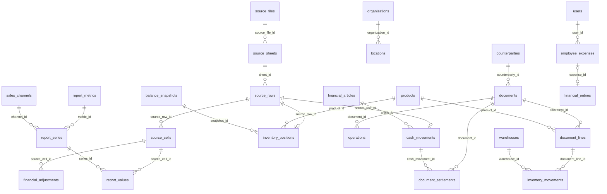

# Qarzhy: предметная реляционная архитектура PostgreSQL

Дата: 2026-10-20. База `fin`, схема `qarzhy`, ветка `feat/postgres-migration`.
Статус: уточнённая сводная версия находится в [основной архитектуре](../../database-architecture.md).
Этот файл сохраняет предшествующее обсуждение; при расхождении имён и правил действует основной документ.
Проект для согласования. Заменяет решение использовать ячейки Excel
как основной источник бизнес-отчётов. Существующие SQL и INSERT относятся
к прежней модели; продолжать их импорт для новой модели не требуется.

## Цель и границы

Уточнение пользователя: после первоначального переноса финансист ведёт работу
в программе. PostgreSQL является единственным рабочим источником данных;
сервер не читает Excel/JSON, отчёты не зависят от Excel-формул или координат.
Архив источников ниже нужен только для трассировки миграции. Исторические
агрегаты сохраняются отдельно от новых операций и не учитываются повторно.
Существующий код расчёта по ячейкам потребуется заменить предметными расчётами.

Хранить финансовые сущности в связанных таблицах PostgreSQL, сохранив
текущие интерфейс, показатели, историю и возможность сверки с Excel.
У каждой самостоятельной сущности есть `id bigint identity`, связи — FK
на ID. Дополнительные UNIQUE определяют бизнес-уникальность. Совпадение
строк или чисел не создаёт связь автоматически.

Новая структура остаётся в `qarzhy`. На этапе проектирования удалений,
изменений PostgreSQL и переключения сайта не происходит. Перед заменой
схемы нужен проверенный резервный экспорт существующей схемы и данных;
исходные SQLite с WAL и три JSON также сохраняются. Разрушительный reset
будет отдельным явно обозначенным скриптом после проверки новой структуры.

Это управленческий финансовый портал, не полноценная система двойной записи.
План счетов и проводки debit/credit не добавляются без отдельного требования.

## Что подтверждено кодом и данными

- `server/finance/statements.mjs`: Cash Flow читает строки листа `База`:
  C — дата, D/E — входящий/исходящий поток, F — ответственный, G — статья,
  H — примечание, I — автор. Год и месяц в A/B иногда расходятся с датой;
  интерфейс считает период по C и показывает расхождение.
- Баланс показывает snapshot на 2026-09-01; текущая дата задана в коде.
  Лист `Данные`: A — артикул, B — товар, C — количество, D — издательство,
  E — тип соглашения, F — цена поступления, G — общая сумма.
  Это остатки, не история продаж и закупок.
- Баланс использует отдельные расшифровки касс, поставщиков и групп активов.
  Расшифровки могут расходиться с итогами; разница уже отображается на сайте.
- `server/finance/workbook.mjs`: P&L содержит месячные показатели,
  отдельный исходный годовой итог, каналы продаж и бюджет.
  Годовой итог может отличаться от суммы месяцев; оба значения сохраняются.
- SQLite `operations` — отдельный журнал с собственными правилами расчёта;
  он не является доказанным перечнем операций, породивших Excel-отчёты.
- Пользователи SQLite, авторы Excel и ответственные Excel — разные наборы.
  Совпадение имени не доказывает, что это один аккаунт.
- Существующие книги: 38 листов, 385 661 ячейка. Большое число ячеек
  с повторами и нулевыми формулами не означает столько бизнес-операций.

## Слои модели

1. Справочники: организации, точки, контрагенты, товары, статьи, каналы,
   люди и денежные счета.
2. Предметные данные: журнал операций, движения денег, остатки товаров,
   остатки счетов и задолженностей, показатели P&L, бюджеты.
3. Работа пользователей: расходы, согласование, корректировки, аудит.
4. Происхождение: импортированные файлы, листы, строки и архив ячеек.
   Этот слой служит сверке и хранению формул, а не заменяет предметные таблицы.

## Справочники и доступ

### Подтверждённые роли

| Роль | Полномочия |
| --- | --- |
| Администратор | Все функции сайта и финансов, создание и деактивация учётных записей, назначение и изменение прав, изменение имён/логинов, сброс и смена паролей |
| Финансист | Все финансовые операции и отчёты, проверка, утверждение и отклонение расходов сотрудников; управление учётными записями и правами только администратору |
| Сотрудник | Вносит собственные расходы на рабочие нужды, видит собственные записи и результат проверки; нет доступа к чужим расходам, общим финансовым данным и управлению пользователями |

Изначально предусмотрены 8 сотрудников помимо администратора и финансиста.
Это начальный набор аккаунтов, не ограничение количества пользователей в БД:
администратор вправе создавать новые учётные записи. Названия должностей
8 сотрудников не создают 8 отдельных ролей. Старые неактивные аккаунты
сохраняются для истории и не включаются в число действующих сотрудников.

Рекомендуемая реализация прав: `roles(id,code,name)`,
`permissions(id,code,description)`, `role_permissions(id,role_id,permission_id)`
с UNIQUE пары и `user_permissions(id,user_id,permission_id,allowed)`
с UNIQUE пары для персональных назначений администратора. `users.role_id`
ссылается на roles. Базовые роли: admin, finance, employee. Ограничение
видимости собственными записями проверяется сервером независимо от UI;
переданный клиентом user_id не определяет владельца записи.

Полные права администратора не отменяют транзакции, аудит и ограничения
целостности. Сброс пароля выдаёт временный пароль с обязательной сменой,
аннулирует сессии, не раскрывает старый пароль. Изменения доступа и аккаунтов
аудируются; нельзя деактивировать или лишить прав последнего активного админа.

| Таблица | Ключевые поля и связи |
| --- | --- |
| `organizations` | `id`, `name`, `active`; только подтверждённые организации |
| `locations` | `id`, `organization_id → organizations`, `name`; UNIQUE организации и названия точки |
| `users` | `id`, `username`, имя, `role_id → roles`, язык, active, password salt/hash; nullable `organization_id`, `location_id`; точка согласована с организацией |
| `sessions` | `id`, `user_id → users`, UNIQUE `token_hash`, сроки; старые сессии не импортируются |
| `persons` | `id`, исходное имя, необязательный `user_id → users`; отдельная справочная личность, без автоматического сопоставления по имени |
| `counterparties` | `id`, имя, проверенный внешний идентификатор при наличии; одинаковое имя само по себе не UNIQUE |
| `counterparty_roles` | `id`, `counterparty_id → counterparties`, роль; один контрагент может быть поставщиком и покупателем |
| `products` | `id`, наименование, артикул; уникальность артикула только внутри подтверждённого пространства кодов |
| `agreement_types` | `id`, код, название (`Предоплата`, `Реализация`, иные фактические типы) |
| `financial_articles` | `id`, стабильный код, название, nullable `parent_id → financial_articles`; дерево без циклов |
| `sales_channels` | `id`, код, название, nullable `location_id → locations`; канал не обязательно торговая точка |
| `cash_accounts` | `id`, название, валюта KZT, nullable `organization_id`; неизвестного владельца не придумываем |

Значения из старых строк сопоставляются через явные таблицы соответствия
импорта. Разные исходные подписи могут ссылаться на один ID только после
подтверждённого сопоставления. Неопределённые совпадения сохраняются отдельно
и попадают в отчёт проверки, не сливаются автоматически.

## Источники и трассировка

| Таблица | Ключевые поля и связи |
| --- | --- |
| `import_batches` | `id`, время снимка, статус, fingerprint; повторный импорт того же набора не создаёт дубли |
| `source_files` | `id`, `import_batch_id`, тип книги pnl/balance/cashflow/sqlite, имя, sha256, исходное время импорта |
| `source_sheets` | `id`, `source_file_id → source_files`, имя, порядок, диапазон, hidden; UNIQUE `(source_file_id,name)` |
| `source_rows` | `id`, `sheet_id → source_sheets`, номер строки; UNIQUE `(sheet_id,row_number)` |
| `source_cells` | `id`, `source_row_id → source_rows`, номер столбца, исходный адрес, тип и типизированное значение, формула, дополнительные метаданные; UNIQUE `(source_row_id,column_number)` |
| `import_entity_mappings` | `id`, источник, пространство кодов, исходный ключ, конкретный FK на организацию/товар/контрагента/статью/личность/канал/счёт; CHECK ровно одна целевая ссылка заполнена |
| `import_issues` | `id`, `import_batch_id`, nullable `source_row_id`, код, описание, статус разрешения |

В предметных таблицах `source_row_id`/`source_cell_id` — настоящие FK.
Адрес `C8319` хранится как исходная координата и не заменяет ID.
Внешние ссылки на Excel и shared-formula метаданные остаются архивом;
текстовые формулы не объявляются FK. Граф зависимостей формул потребовал бы
полноценного разбора Excel, который не входит в данный перенос.

Архив сохраняет все ячейки, включая технические и не используемые интерфейсом,
чтобы выполнить исходное требование перенести все данные. В новой модели
`sheet` и `book` не повторяются текстом в каждой ячейке: они доступны через FK.

## Предметные таблицы

### Продажи и закупки: два подтверждённых способа ввода

Пользователь подтвердил оба режима: общий суммовой документ и документ
с товарами, количеством и ценой. Они относятся к одной предметной модели.

- `documents`: `id`, `dataset_id`, `organization_id`, nullable `location_id`,
  `counterparty_id`, вид sale/purchase/return, номер, дата, срок оплаты,
  режим `summary`/`itemized`, статус draft/posted/reversed, валюта KZT,
  автор, timestamps, version. У итогового документа одна сумма, рассчитанная
  из детализации либо явно введённая для summary. Возврат связан FK
  с исходным документом, когда он известен.
- `document_lines`: `id`, `document_id → documents`, номер строки,
  `product_id → products`, количество, цена, сумма скидки, итог строки,
  nullable `warehouse_id → warehouses`; UNIQUE `(document_id,line_number)`.
  Цена и количество хранятся точно; правило округления денежного итога
  фиксируется при реализации, расхождение с введённым итогом не скрывается.
- `warehouses`: `id`, `organization_id`, название, nullable `location_id`.
  Склад должен принадлежать организации документа.
- `inventory_movements`: `id`, `document_line_id → document_lines`,
  `warehouse_id → warehouses`, дата, количество прихода/расхода, стоимость,
  ссылка на сторнируемое движение при отмене. Ровно одно проведение одной
  товарной строки на склад; повторный запрос не создаёт второе движение.
- `document_settlements`: `id`, `document_id → documents`,
  `cash_movement_id → cash_movements`, выделенная сумма. Поддерживает
  частичную оплату и распределение одного платежа между документами.
  Сумма распределений не превышает доступную сумму платежа; проверка
  выполняется транзакционно с блокировкой документа и платежа.

Summary-документ не создаёт товарных строк и не изменяет складские остатки.
Без источника себестоимости прибыль по такой продаже нельзя достоверно
вычислить: себестоимость вводится отдельно с основанием либо остаётся
неизвестной и показывается как неполнота данных. Она не заменяется нулём.

Itemized-документ рассчитывает общий итог по строкам. Строки и заголовок
не считаются двумя разными продажами. В draft допустима незавершённость;
при posted itemized требует строки, summary запрещает строки. Эти правила
контролируются транзакцией проведения и отложенными проверками БД.

Проведение документа создаёт связанные записи `operations` один раз;
`operations.document_id` и, при детализации, `document_line_id` — FK,
а ключ проведения обеспечивает идемпотентность. Отчёты берут финансовые
факты из operations, не прибавляя повторно documents/document_lines.
Для каждой строки проведения определены вид и уникальный ключ события.

Продажа признаёт выручку и задолженность, закупка — поступление/задолженность
по своему виду. Оплата учитывается отдельным движением денег, связанным
через document_settlements, и не создаёт выручку или расход повторно.
Возврат/сторно сохраняет исходный документ и историю.

Автоматическую себестоимость нельзя включать до выбора метода оценки
остатков (например, средневзвешенная или FIFO) и правил отрицательного
остатка/задних дат. Пока эти правила не согласованы, структура поддерживает
складские движения и явно заданную себестоимость с источником; автоматическая
оценка остаётся отдельной обязательной частью дизайна перед реализацией.

| Таблица | Ключевые поля и связи |
| --- | --- |
| `datasets` | `id`, код (`legacy_ledger`, `workbook_finance`), описание; разделяет независимые модели фактов |
| `report_scopes` | `id`, тип consolidated/organization, nullable `organization_id`; CHECK согласованности; исходный общий отчёт не размножается по трём организациям |
| `accounting_periods` | `id`, начало месяца, closed, updated_by → users; UNIQUE начала месяца |
| `documents` | `id`, `dataset_id`, `organization_id`, nullable `counterparty_id`, номер/тип документа; уникальность только по достаточному исходному ключу, не только номеру |
| `operations` | `id`, dataset, организация, точка, контрагент, документ, статья через FK, date, due, kind, amount, cost; исходные source/external_id для дедупликации |
| `payment_plans` | `id`, dataset, организация, статья через FK, дата, сумма, направление |
| `cash_movements` | `id`, dataset, scope, nullable cash_account, article, nullable responsible_person/author_person через FK, date, inflow, outflow, note, `source_row_id` UNIQUE; сохраняются оба потока одной исходной строки |
| `balance_snapshots` | `id`, dataset, scope, дата, исходная подпись даты, source_file; отсутствие или неоднозначность даты требует явного правила импорта |
| `inventory_positions` | `id`, `snapshot_id`, `product_id`, nullable `publisher_id → counterparties`, `agreement_type_id`, quantity, unit_cost, total_value, `source_row_id` UNIQUE |
| `cash_balances` | `id`, `snapshot_id`, `cash_account_id`, amount, source_cell; не создаёт фиктивного движения денег |
| `counterparty_balances` | `id`, `snapshot_id`, `counterparty_id`, вид receivable/payable, amount, source_cell |
| `asset_groups` | `id`, название группы |
| `asset_group_balances` | `id`, `snapshot_id`, `asset_group_id`, amount, source_cell |
| `report_metrics` | `id`, код, название, единица amount/quantity/ratio, тип входной/расчётный; отдельные метрики выручки, себестоимости, налога и т.д. |
| `report_series` | `id`, dataset, scope, семейство pnl/balance/budget/sales, metric_id, nullable article_id/channel_id; UNIQUE NULLS NOT DISTINCT по этим измерениям |
| `report_values` | `id`, series_id, период начала/конца, вид monthly/source_ytd/snapshot, nullable value, состояние reported/missing/not_available, source_cell_id; UNIQUE `(series_id,period_start,period_end,period_kind)` |

`report_values` хранит именно исходные агрегаты, в том числе годовые и бюджетные.
Детальные строки P&L различаются через статьи; канальные значения — через
канал. Названия и исходный порядок строк сохраняются в справочнике статей
и трассировке. Вложения метрик и статей задаются явно: общий итог не
прибавляется к своим деталям. Балансные итоги, их расшифровки и вычисленные
контрольные значения остаются различимыми.

Если старый источник не содержит продаж по товарам или истории закупок,
не создаём фиктивные товарные документы из итогов P&L или остатков.
Новые документы поддерживают оба режима сразу; historical report_values
и начальные inventory_positions сохраняют фактическую детализацию источника.

## Расходы, правки и аудит

### Проверка расходов сотрудников

1. Сотрудник отправляет дату, сумму, статью, описание и поставщика; сервер
   устанавливает владельца из текущей сессии. Статус `submitted`.
2. До одобрения запись видна в очереди проверки и личном кабинете, но
   не включается в фактические расходы и финансовые итоги.
3. Финансист или администратор утверждает либо отклоняет запись.
   Решение содержит reviewer_id, время, комментарий и ожидаемую версию записи.
4. Одобрение одной транзакцией меняет статус на `approved`, создаёт ровно
   одну связанную финансовую запись, записывает решение и аудит, увеличивает
   revision. UNIQUE expense_id и блокировка/проверка версии защищают от
   двойного нажатия и одновременного одобрения двумя проверяющими.
5. Отклонение даёт `rejected`, сохраняет причину; в фактических расходах
   записи нет. Правка и повторная отправка сотрудником возвращают `submitted`.
6. Утверждённую запись сотрудник не редактирует и не удаляет. Исправление
   проверяющим сохраняет историю и обновляет/сторнирует связанный расход
   одной транзакцией. Закрытый период требует установленной процедуры открытия.

Добавить `expense_reviews(id,expense_id → employee_expenses,
reviewer_id → users,decision,note,reviewed_at,expense_version)` для истории
решений. В employee_expenses дополнительно хранить последние reviewed_by,
reviewed_at и version; история не перезаписывается последующим решением.

В отчётах сумма берётся из единственного финансового факта, а не из суммы
employee_expenses плюс financial_entries. Пока финансовый движок не уточнён,
financial_entries — выбранный источник факта одобренного расхода.
Признание расхода и движение денег различаются: утверждение само по себе
не доказывает списание с конкретного счёта. Оплата/возмещение связывается
с cash_movement отдельно; существующие cash_effect данные сверяются при переносе.

| Таблица | Ключевые поля и связи |
| --- | --- |
| `employee_expenses` | `id`, user_id, article_id, дата, сумма, описание, vendor text и nullable vendor_id, статус, версия, deleted_at, timestamps |
| `financial_entries` | `id`, dataset/scope, metric_id, nullable article_id, date, amount, note, cash_effect, UNIQUE nullable expense_id, author_id, active |
| `financial_adjustments` | `id`, source_cell_id, value, reason, author_id, timestamps, active; уникальная активная правка на ячейку |
| `financial_state` | `id`, revision; один глобальный счётчик совместимости текущего API |
| `audit` | `id`, timestamp, nullable author_id, историческое author_name, действие, detail/jsonb; без сопоставления имени с аккаунтом |
| `schema_migrations` | `id`, UNIQUE version, applied_at; отдельно сохраняется история миграций SQLite |

В ежедневной работе корректируются предметные записи/исторические показатели,
а не source_cell. `financial_adjustments` в таблице выше описывает только
перенос старых исправлений; рабочая корректировка должна ссылаться FK на
конкретный финансовый факт/показатель и хранить причину, автора и историю.
При переносе прежняя правка source_cell применяется к связанному предметному
значению; нельзя обновить только архив и оставить отчёт старым.
Старые правки с другим base_hash ссылаются на
соответствующую версию источника или сохраняются как неприменимые с причиной;
переназначать их новой книге нельзя. Подтверждение расхода создаёт одну
financial_entry по UNIQUE expense_id; отклонение деактивирует её.

## Основные связи

Диаграмма показывает главные связи; nullable FK и все ограничения уточняются
в DDL. Ссылки на аккаунты, источники, остатки и финансовые факты — RESTRICT
при удалении. Справочники деактивируются, финансовые изменения аудируются.

## Типы, ограничения, расчёты

- UUID не нужен для локальных реляционных ключей: bigint identity достаточно.
  Старые пользовательские и операционные ID сохраняются, если нет конфликтов.
- Денежные суммы операций и пользовательских расходов — `numeric(20,2)` KZT.
  JSON-значения, исходные отчётные суммы, количества, коэффициенты и цены —
  `numeric` без фиксированного масштаба. Исходные отрицательные значения
  и возвраты допускаются там, где они уже встречаются; amount>0 не применяется
  ко всем финансовым таблицам без учёта смысла.
- `amount_cents` SQLite делится на 100 точно только в расходах и financial_entries.
  amount/cost журнала уже в тенге. Текущий API может сохранить amount_cents
  через серверное преобразование; формат интерфейса отдельно не меняется.
- NULL отличается от нуля; отсутствие будущих фактов не заполняется нулями.
- `date` для дней, `timestamptz` для событий; server timezone UTC.
- Неизвестная организация, валюта или контрагент не определяется догадкой.
  Общие Excel-отчёты получают consolidated scope, KZT соответствует текущему коду.
- Закрытые периоды защищают операции, финансовые записи и относящиеся к периоду
  исправления/значения. Закрытие синхронизируется с записью одной транзакцией.
- Индексы на FK, `(dataset_id,date)`, `(scope_id,date)`, периоды series и фильтры
  активных/неудалённых записей. revision увеличивается один раз на логическую правку.
- Журнал, workbook cashflow и исходные агрегаты не складываются между собой.
  Для каждого маршрута отчёта фиксируется dataset и правило расчёта.

## Карта переноса

| Источник | Целевая модель | Что не выводим из него |
| --- | --- | --- |
| SQLite users/expenses/entries/audit | одноимённые сущности, справочники FK | автора Excel по имени аккаунта |
| SQLite operations/plans/budgets | legacy_ledger operations/payment_plans/report_values | реальные операции workbook |
| Cash Flow `База` | cash_movements + persons + articles + provenance | неизвестные счета и организации |
| Баланс `Данные` | inventory_positions + products + publishers + agreement_types | историю закупок/продаж |
| `касса`, свод поставщиков и группы активов | snapshot-расшифровки | движения, породившие остатки |
| P&L, продажи по каналам и бюджет | report_series/report_values + metrics/articles/channels | товарные продажи без первичных строк |
| Все JSON, включая технические листы | архив source_files/sheets/rows/cells | фиктивные бизнес-факты из технических формул |

Внешние ключи назначаются из таблиц соответствий, не из Excel-адресов.
Исходные дубликаты SKU, спорные названия документов и неоднозначные даты
сохраняются с provenance и отмечаются для проверки. Подготовка финального
импорта останавливается на неразрешённых обязательных связях.

## Как перейти в той же схеме

1. Проверить этот документ и утвердить предметную модель.
2. Подготовить DDL, карту полей импорта и повторяемый мигратор; сначала
   собрать новую схему на временной тестовой PostgreSQL, не в рабочей `fin`.
3. Полностью загрузить локальный снимок SQLite+JSON в тестовую схему,
   сравнить источники, предметные факты и ответы всех текущих отчётов.
4. Снять резервную копию `fin.qarzhy`. Зафиксировать остановку записи.
5. Отдельно подтверждённым скриптом заменить только `qarzhy` в `fin`,
   создать новую структуру и выполнить проверенный перенос.
6. Переключить серверные репозитории и выполнить API/интерфейсные проверки.
   При несовпадении восстановить предыдущую схему и прежний сервер.

До шага 5 никаких DROP/TRUNCATE. Старые 39 INSERT-частей несовместимы
с новой моделью и не являются миграцией в неё.

## Критерии готовности

- Полный архив воспроизводит 3 исходных JSON и сохраняет все исходные значения,
  формулы и метаданные; проверка повторяется на фактическом снимке.
- Все обязательные FK валидны; нет потерянных строк, незаметного объединения
  разных товаров или контрагентов, дублей повторного импорта.
- Суммы и количество строк Cash Flow, товаров, расходов и журнала совпадают
  с источниками по независимым контрольным срезам.
- Совпадают месячные, YTD, канальные P&L, бюджеты, баланс, Cash Flow и
  существующие предупреждения о расхождениях. Округление только на отображении.
- Работают расходы/согласование, ручные правки, revision, закрытие периода,
  роли, вход и экспорт. Агрегаты не учитываются повторно как операции.
- DDL, миграция и тесты проходят на PostgreSQL целевой версии; сформированы
  отчёт сверки, план переключения и проверенный способ восстановления.
